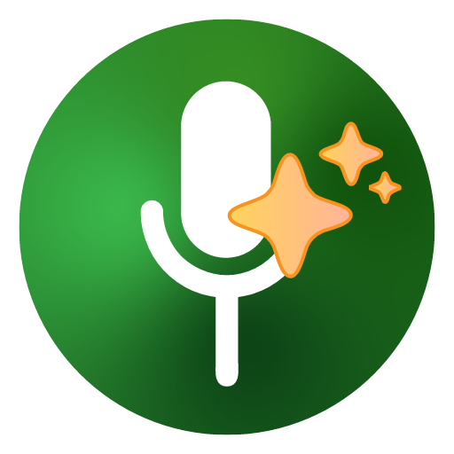

<p align="center">
  
</p>

<h1 align="center">DIBE — private transcription, live while you record</h1>

<p align="center">
  <strong>Transcribe audio and video right on your computer. Nothing leaves your device.</strong>
</p>

<hr />

**DIBE turns speech into text on your own computer.** Record and watch the transcript appear live, or transcribe audio and video files — it works offline and nothing leaves your device. To install it, open the [latest release](https://github.com/akucbruhu0-cyber/dibe/releases/latest) and download `macos-arm64.zip` for Apple Silicon Macs, `macos-intel.zip` for Intel Macs, or `windows-x64-setup.exe` for Windows. Install it (on a Mac, drag `DIBE.app` into Applications), open it, pick a model to download, and press record or choose a file. Your computer warns you the first time because DIBE is unsigned; the [Download](#download) section shows how to allow it.

<div dir="rtl">

**DIBE הופכת דיבור לטקסט על המחשב שלכם.** מקליטים ורואים את התמלול מופיע בזמן אמת, או מתמללים קובצי אודיו ווידאו. הכול עובד בלי אינטרנט ושום דבר לא יוצא מהמכשיר. להתקנה, פותחים את [הגרסה האחרונה](https://github.com/akucbruhu0-cyber/dibe/releases/latest) ומורידים `macos-arm64.zip` למק עם Apple Silicon,‏ `macos-intel.zip` למק עם Intel, או `windows-x64-setup.exe` ל-Windows. מתקינים (במק גוררים את `DIBE.app` אל Applications), פותחים, בוחרים מודל להורדה ולוחצים על הקלטה או בוחרים קובץ. בפתיחה הראשונה המחשב יציג אזהרה כי DIBE לא חתומה. ההוראות לאישור נמצאות בסעיף [Download](#download).

</div>

<hr />

DIBE is a fork of [Vibe](https://github.com/thewh1teagle/vibe) by [thewh1teagle](https://github.com/thewh1teagle), released under the same MIT license. It keeps everything Vibe does and adds live transcription, a more reliable recorder, Google Gemini for AI summaries, and no analytics at all. It installs beside Vibe (its own name, icon, data folder and `dibe://` links), and on first launch it copies Vibe's models, settings and projects so you can start where you left off — without using extra disk space.

## What DIBE adds

- 🔴 **Live transcription while recording** — finished sentences appear within a second or a few of when they are said, with a grey line for the sentence still being spoken. Keep the live transcript when you stop, or transcribe the recording again for the best accuracy (automatic if the live text was incomplete).
- 📖 **A live transcript to work from** — it fills the window at the text size you choose, as timed lines or one block of prose; edit it while it is still being written, copy without the times, and download everything so far without stopping.
- ⏯️ **Pause and resume** a recording: a pause stops the microphone and frees the model, and the resume picks up after any length of time. Get back to the live transcript from any screen with one click.
- 🔋 **Easy on the battery** — live transcription sends audio every few seconds instead of four times a second; turn off the words-as-spoken preview, or turn on the battery saver to send every 10 or 30 seconds, for the largest saving.
- ✏️ **Edit a finished transcript** as one document, the same editor as the live one, saved to the project.
- 📎 **Files and images for the AI summary** — attach images, PDFs and text files to the summary prompt.
- 📄 **Exports that look right** — AI summaries come out with real headings, bold text and lists in Word, PDF and HTML, not Markdown marks.
- 🗑️ **Delete the recording only** — free the disk space and keep the transcript and summary.
- 💾 **Recordings that survive crashes** — audio is written off the real-time thread, checkpointed every 5 seconds, and an unfinished recording is recovered as a project on the next launch.
- 🎧 **Two devices, one recording** — if one device disconnects (for example AirPods switching to a call), the others keep recording.
- ✨ **Google Gemini** for summaries and dictation clean-up, beside Claude, any OpenAI-compatible API and Ollama.
- 🔒 **No analytics** — the telemetry plugin and every event are removed; DIBE sends nothing to anyone.
- 🛡️ **A locked local API** — the transcription server requires a per-launch token and refuses browser requests.
- 🧹 **Model storage** — see how much space models take, find byte-identical duplicates and leftovers, delete them with a confirmation.
- 🪟 Fixes: the window can be dragged by its title bar on macOS; cancelling a transcription is immediate; uploads are streamed to disk instead of held in memory twice; and more (see the [changelog](CHANGELOG.md)).

## Everything from Vibe

- 🌍 Transcribe almost every language, fully offline
- 🎙️ Transcribe audio, video, the microphone and system audio
- 🎶 Transcribe audio from popular websites (YouTube, Vimeo, Facebook, X and more)
- 📂 Batch transcription
- 📝 Export to `SRT`, `VTT`, `TXT`, `HTML`, `PDF`, `JSON`, `DOCX`
- 🤖 Whisper, Nemotron and Parakeet TDT v3 models, GPU-accelerated
- 👥 Speaker diarization and a stable-timestamps mode for subtitles
- 🌐 Translate to English from any language
- ⌨️ Global dictation hotkey
- 📱 Record from your phone and let the computer transcribe
- 📥 Add custom models from your own site with `dibe://download/?url=<model url>`
- ⚡ A local HTTP API with Swagger docs and an agent skill for Claude Code / Codex
- 🖥️ Command line: `/Applications/DIBE.app/Contents/MacOS/dibe --help`

## Platforms

DIBE is developed and tested on **macOS (Apple Silicon)**. The **Intel Mac** and **Windows** builds are made automatically and checked to install and start, but they are not used day to day, so please report anything that misbehaves. Intel Macs have no speaker diarization. The code still builds for Linux like Vibe's, but no Linux build is published.

## Download

Get the file for your computer from the [latest release](https://github.com/akucbruhu0-cyber/dibe/releases/latest):

| Computer | File |
| --- | --- |
| Mac with Apple Silicon | `DIBE-<version>-macos-arm64.zip` |
| Mac with Intel | `DIBE-<version>-macos-intel.zip` |
| Windows 10 / 11 (64-bit) | `DIBE-<version>-windows-x64-setup.exe` |

**Mac**

1. Unzip it and drag `DIBE.app` into `/Applications`.
2. DIBE is not notarized by Apple, so macOS blocks the first launch. Allow it once in **System Settings → Privacy & Security → Open Anyway**, or run:

   ```console
   xattr -dr com.apple.quarantine /Applications/DIBE.app
   ```

3. Open DIBE, pick a model to download, and allow the microphone when asked.

**Windows**

1. Run the installer. DIBE is not code-signed, so Windows may show "Windows protected your PC": choose **More info → Run anyway**.
2. Open DIBE, pick a model to download, and allow the microphone when asked.

Already using Vibe? DIBE copies your Vibe models, settings and projects on its first launch; Vibe keeps working unchanged.

## Build from source

See [docs/BUILDING.md](docs/BUILDING.md); the short version for macOS:

```console
pnpm install
chore setup            # ffmpeg (and Vibe's released server, replaced on the next line)
chore server-build     # build the transcription server from this repository — required for live transcription
cd desktop && pnpm exec tauri build --bundles app
```

The app lands in `target/release/bundle/macos/DIBE.app`. It is unsigned: sign it locally before moving it to `/Applications` so macOS remembers the microphone permission:

```console
codesign --force --deep --sign - --entitlements desktop/src-tauri/entitlements.plist target/release/bundle/macos/DIBE.app
```

DIBE never updates itself: download the new release, or pull and rebuild.

## Privacy

Transcription runs on your device. DIBE contacts the internet only when you ask it to — downloading a model, transcribing a web link, using an AI provider you configured, or pairing a phone. Details in [PRIVACY.md](PRIVACY.md).

## Contribute

Issues and pull requests are welcome: [CONTRIBUTE.md](CONTRIBUTE.md). Translations: [docs/TRANSLATIONS.md](docs/TRANSLATIONS.md). Security reports: [SECURITY.md](SECURITY.md).

## Credits

DIBE exists because of [Vibe](https://github.com/thewh1teagle/vibe) and its author [thewh1teagle](https://github.com/thewh1teagle) — consider [supporting the original project](https://thewh1teagle.github.io/vibe/?action=support-vibe). Models, model documentation and the phone page are still served by the Vibe project.

Built with [Tauri](https://tauri.app/), [whisper.cpp](https://github.com/ggml-org/whisper.cpp) / [ggml](https://github.com/ggml-org/ggml), OpenAI's [Whisper](https://openai.com/research/whisper), NVIDIA's Parakeet and Nemotron models, and many other open-source libraries.

## License

[MIT](LICENSE) — © thewh1teagle (Vibe) and © akucbruhu0-cyber (DIBE changes).
